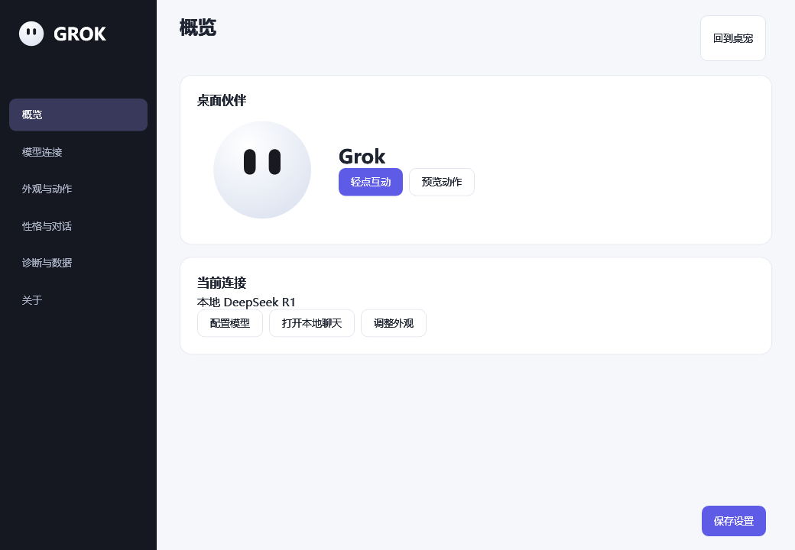

# Grok Desktop Pet

一个原生 Windows AI 桌宠。球面眼睛跟随鼠标，点击和拖拽后由 AI 决定台词、表情与动作。

**[下载独立 EXE](https://github.com/necx26/GrokDesktopPet/releases/latest/download/GrokPet.exe)** · [版本下载](https://github.com/necx26/GrokDesktopPet/releases)

无需另装 .NET。模型、API Key 和推理服务需要自行配置。



## 功能

- 球面眼睛投影与边缘遮挡，平滑跟随鼠标。
- 直接跟手拖拽、速度形变、松手回弹。
- AI 控制台词、眼神、双眼开合、偏移、伸缩和倾斜。
- 气泡渐入渐出；待机不调用模型。
- 可视化设置：模型连接、外观动作、性格对话、诊断与配置备份。
- 多连接配置、模型列表、连接测试、配置导入导出。
- Windows 凭据管理器保存 API Key，导出不含密钥。
- 单实例；与已有本地聊天服务共用模型。

## 开始使用

1. 下载并双击 `GrokPet.exe`。
2. 在「模型连接」选择服务、填写地址和模型 ID，按需填写 API Key。
3. 测试连接，启用配置，保存。

单击球体互动，按住拖动，右键打开控制中心。关闭控制中心保留桌宠；退出桌宠保留模型服务。

| 服务 | 地址示例 |
| --- | --- |
| llama.cpp / DeepSeek R1 快速模式 | `http://127.0.0.1:8080` |
| llama.cpp 兼容 API | `http://127.0.0.1:8080/v1` |
| LM Studio | `http://127.0.0.1:1234/v1` |
| Ollama 兼容 API | `http://127.0.0.1:11434/v1` |
| DeepSeek API | `https://api.deepseek.com/v1` |
| 自定义服务 | 兼容 OpenAI 的接口基础地址 |

R1 快速模式使用 llama.cpp 的 `/completion` 与 R1 模板，适用于 DeepSeek-R1-0528-Qwen3-8B 等对应模板模型。其他模型选择兼容 API 模式。

兼容模式调用 `/chat/completions`。可选 JSON 模式需要服务支持 `response_format`；不支持时关闭。模型列表使用 `/models`，没有列表的服务可以手动输入模型 ID。接口兼容不代表所有模型都能稳定返回动作 JSON。

### 自动启动本地模型

在「诊断与数据」选择 `llama-server.exe` 和 `.gguf` 文件。启用本机 8080 的 R1 快速连接后，程序会检查已有服务；未运行时才自动加载。也可使用默认相对路径 `llama.cpp/llama-server.exe` 和 `models/model.gguf`。使用云 API 时不会自动启动本地模型。

## 构建

Windows x64，.NET 10 SDK：

```powershell
.\scripts\build.ps1
.\artifacts\GrokPet.exe
```

默认生成内置运行时的独立单文件 EXE。自解压运行时会使用 Windows 临时目录。

## 验证

先退出已有桌宠，再运行：

```powershell
# 本机模拟兼容 API、鉴权与错误处理、六页渲染、球面几何和待机检查
.\artifacts\GrokPet.exe --verify --offline

# 额外测试当前已配置的真实本地模型
.\artifacts\GrokPet.exe --verify
```

结果在 EXE 同目录的 `data/verification/results.json`。测试失败返回非零退出码。真实云账号尚未在项目初版验证中测试；兼容 API 的请求格式使用本机模拟服务验证。

## 数据与隐私

配置和有大小上限的状态日志位于 EXE 同目录的 `data/`。互动记忆只在内存中保留。API Key 存在当前 Windows 用户的凭据管理器中，不进入 JSON、日志和配置导出。导入连接配置会使用新的凭据标识，需要重新填写密钥。

程序不读取屏幕、浏览器历史或其他文件，无遥测。点击、拖拽事件和主动输入仅发送到你选择的模型服务。AI 返回受限的视觉动作数据，程序不执行模型生成的命令。

## 许可证

[MIT](LICENSE)。来源说明见 [NOTICE.md](NOTICE.md)。这是独立社区项目，与 xAI / Grok 官方服务无隶属关系。
